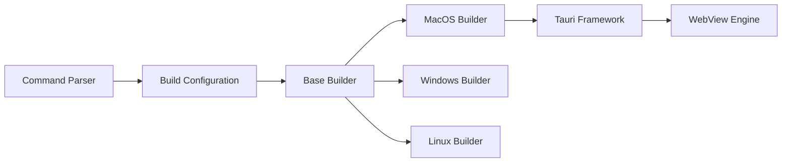

# tw93/Pake

> CLI that wraps a website into a lightweight desktop app using Rust Tauri.

## The problem
Turning a website into a native app with Electron produces heavy packages that consume a lot of memory.

## What it actually does
`pake <url> --name X` generates a Mac/Windows/Linux app with the icon fetched automatically, window size, and hidden title bar.
Navigation shortcuts, CSS/JS injection, immersive window.
`--json` mode and `--config app.json` to drive it from a script or an agent; ready-made packages (ChatGPT, YouTube…) in Releases.
Online build through GitHub Actions is possible.

## How it is wired


## Trying it
```bash
pnpm install -g pake-cli
pake https://github.com --name GitHub
pnpm i
pnpm run dev
```

## Cost and gotchas
First packaging is slow (environment setup); local development: Rust ≥ 1.85 and Node ≥ 22.

## What it is not
Not an app framework: just a WebView container around a website. GPL-3.0. The architecture diagram provided is generic, not drawn from the code.

## Alternatives
Not documented: Electron is cited as a comparison, with no named repository.

## For you
Outside the data/AI scope; a handy gadget for pinning a web tool, nothing more.
