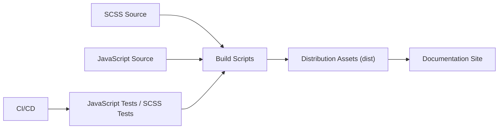

# twbs/bootstrap

> Front-end framework of CSS and JavaScript components for responsive web interfaces, aimed at web developers.

## The problem
Hand-writing a consistent responsive interface takes time: grid, forms, buttons, modals.

## What it actually does
Bootstrap 5 provides compiled CSS (grid, reboot, utilities, RTL and minified versions) and component JavaScript (the bundles include Popper). The sources are in SCSS and JS, compiled by build scripts (Rollup, PostCSS) into `dist`. The documentation is built with Astro (the graph mentions Hugo, a contradiction with the README, which prevails).

## How it is wired


## Trying it
```bash
npm install bootstrap@v5.3.8
yarn add bootstrap@v5.3.8
composer require twbs/bootstrap:5.3.8
git clone https://github.com/twbs/bootstrap.git
npm run docs-serve
```

## Cost and gotchas
Free. The default branch is Bootstrap 5; Bootstrap 4 is on `v4-dev`. For the local docs, you must first run `npm install`, then `npm run test` to rebuild the assets.

## What it is not
Not an application JavaScript framework: no state management or routing. Nor is it a turnkey customizable design system.

## Alternatives
No alternative named in the README.

## For you
Ignore: only useful if you style a web front end by hand; a data/AI profile would rather use a dashboard tool.
