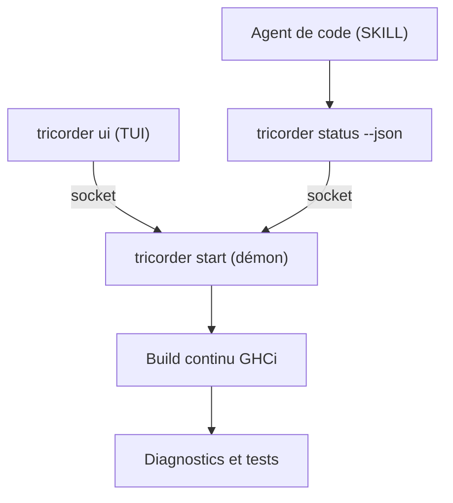

# tweag/tricorder

> Continuous build daemon for Haskell that informs humans and code agents: diagnostics, tests, documentation.

## The problem
Developing in Haskell with a code agent forces you to rerun builds and tests with no shared state.

## What it actually does
A daemon compiles continuously on every change, displays diagnostics and runs tests, like ghcid or ghciwatch. A text interface (tricorder ui) and the tricorder status command query the same daemon through a socket. A SKILL is provided for agents, and the output is available as JSON. It detects the packages of cabal and stack projects.

## How it is wired


## Trying it
```bash
cabal install tricorder
# ou
stack install tricorder
tricorder ui
```

## Cost and gotchas
Linux and macOS only. On NixOS, you may need the --constraint='zlib +bundled-c-zlib' option. Free, no API key.

## What it is not
It is not a general-purpose tool: it only targets Haskell projects using cabal or stack. The repository also contains Atelier, Haskell libraries announced as to be extracted.

## Alternatives
- ghcid: same continuous-reload idea, simpler.
- ghciwatch: another tool of the same kind cited in the README.

## For you
Ignore unless you write Haskell: the gain comes from the integration with code agents, useful only in that ecosystem.
