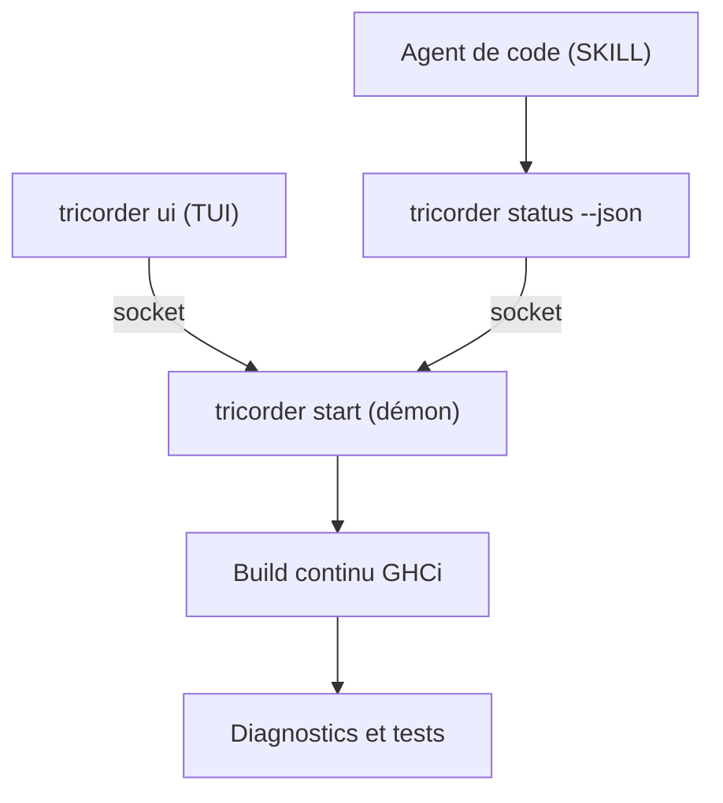

# tweag/tricorder

> Démon de build continu pour Haskell qui informe humains et agents de code : diagnostics, tests, documentation.

## Le problème
Développer en Haskell avec un agent de code oblige à relancer builds et tests sans état partagé.

## Ce que ça fait vraiment
Un démon compile en continu à chaque changement, affiche les diagnostics et lance les tests, comme ghcid ou ghciwatch. Une interface texte (tricorder ui) et la commande tricorder status interrogent le même démon via une socket. Un SKILL est fourni pour les agents, et la sortie existe en JSON. Il détecte les paquets des projets cabal et stack.

## Comment c'est branché


## Essayer
```bash
cabal install tricorder
# ou
stack install tricorder
tricorder ui
```

## Coût et pièges
Linux et macOS seulement. Sur NixOS, il peut falloir l'option --constraint='zlib +bundled-c-zlib'. Gratuit, sans clé d'API.

## Ce que ce n'est pas
Ce n'est pas un outil généraliste : il ne vise que les projets Haskell cabal ou stack. Le dépôt contient aussi Atelier, des bibliothèques Haskell annoncées comme à extraire.

## Alternatives
- ghcid : même idée de rechargement continu, plus simple.
- ghciwatch : autre outil du même type cité dans le README.

## Pour toi
À ignorer sauf si tu écris du Haskell : le gain vient de l'intégration avec les agents de code, utile seulement dans cet écosystème.

