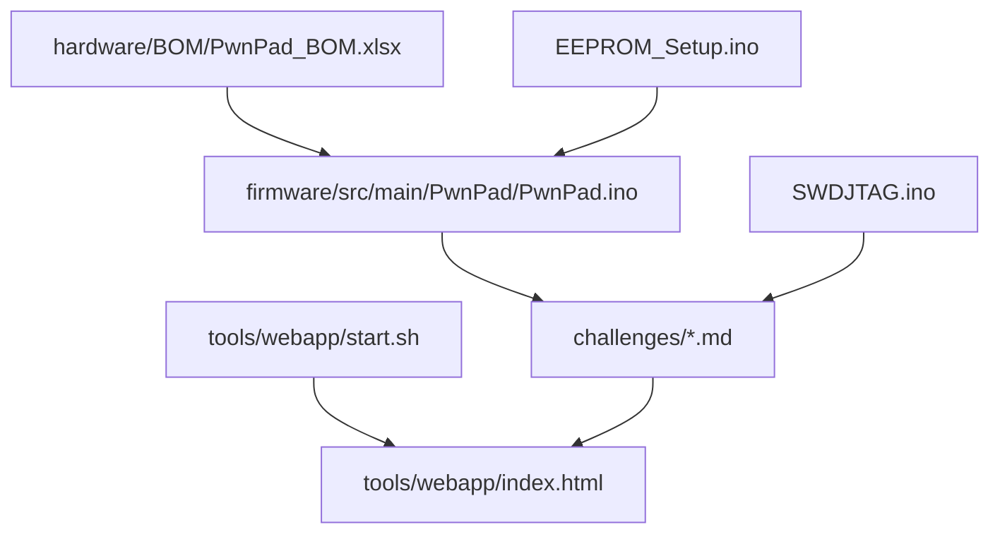

# twelvesec/PwnPad

> Learning board for hardware hacking (UART, SPI, I2C, glitching), for beginners in embedded security.

## The problem
Learning hardware hacking requires expensive equipment and legal targets to practise on.

## What it actually does
A build-it-yourself board (under $20) whose firmware embeds 15 gamified challenges. You pick the challenge with 5 jumpers, without reflashing. The instructions are in challenges/, and a small local web app tracks submitted flags. The challenges cover UART, I2C, firmware extraction, fault injection, side channels, SWD and JTAG.

## How it is wired
Diagram based on the code's diagram.



## Trying it
```bash
bash ./tools/webapp/start.sh
# puis ouvrir http://127.0.0.1:12530
```

## Cost and gotchas
About $20 for the board and $50 for tools (multimeter, Arduino UNO, logic analyser, Raspberry Pi Pico). You must solder and have the PCB manufactured. The SPA challenge requires a basic oscilloscope.

## What it is not
Not an attack tool: it is a training bench with its own targets. Not a turnkey product: you have to build the board.

## Alternatives
No alternative named in the README.

## For you
Worth watching: useful only if you want to get into hardware hacking, otherwise unrelated to a data / AI / MLOps path.
