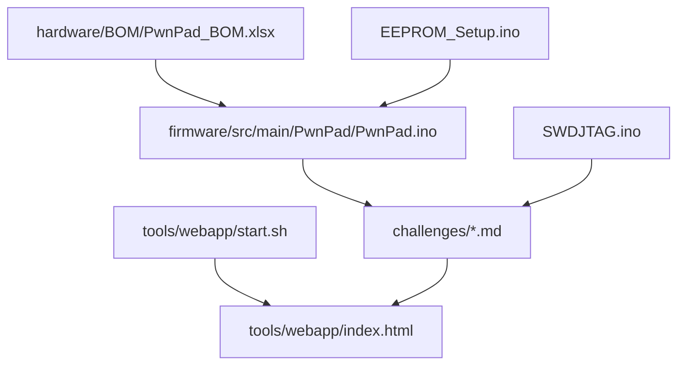

# twelvesec/PwnPad

> Carte électronique d'apprentissage du hacking matériel (UART, SPI, I2C, glitching), pour débutants en sécurité embarquée.

## Le problème
Apprendre le hacking matériel demande du matériel coûteux et des cibles légales sur lesquelles s'entraîner.

## Ce que ça fait vraiment
Une carte à construire soi-même (moins de 20 $) dont le firmware embarque 15 défis gamifiés. On choisit le défi avec 5 jumpers, sans reflasher. Les consignes sont dans challenges/, une petite appli web locale suit les drapeaux soumis. Les défis couvrent UART, I2C, extraction de firmware, injection de fautes, canaux auxiliaires, SWD et JTAG.

## Comment c'est branché
Schéma d'après le diagramme du code.



## Essayer
```bash
bash ./tools/webapp/start.sh
# puis ouvrir http://127.0.0.1:12530
```

## Coût et pièges
Environ 20 $ de carte et 50 $ d'outils (multimètre, Arduino UNO, analyseur logique, Raspberry Pi Pico). Il faut souder et faire fabriquer le PCB. Le défi SPA demande un oscilloscope basique.

## Ce que ce n'est pas
Pas un outil d'attaque : c'est un banc d'entraînement avec ses propres cibles. Pas un produit clé en main : il faut construire la carte.

## Alternatives
Aucune alternative nommée dans le README.

## Pour toi
Surveiller : utile seulement si tu veux toucher au hardware hacking, sinon sans lien avec un parcours data / IA / MLOps.

