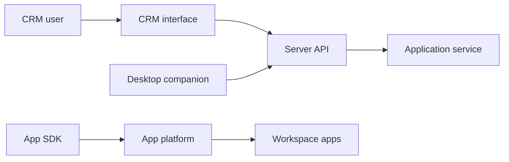

# twentyhq/twenty

> An open-source CRM that the technical teams build and manage, just like the rest of their code.

## The problem
Traditional CRM systems struggle to meet the complex and evolving needs of businesses, and they are difficult to adapt to changes within the company.

## What it actually does
Objects, views, workflows, and agents can be defined in TypeScript using the SDK (`defineObject`) and then published to a workspace. The stack includes: NestJS, BullMQ, PostgreSQL, Redis (server-side), and React (client-side). The repository also contains a companion application for call recording and examples.

## How it is wired


## Trying it
```bash
npm install -g twenty
twenty app init my-app
twenty auth login --url https://your-workspace.twenty.com
twenty app publish --private
```

## Cost and gotchas
Online cloud or self-hosting with Docker Compose; pricing is not specified. The license is not identified by GitHub.

## What it is not
Not a ready-made CRM without development: the key is "the CRM you build".

## Alternatives
No alternative is specified in the README file.

## For you
Things to watch out for: This could be interesting if your team wants a CRM that is driven by code and agents, but that is separate from data/AI work.
