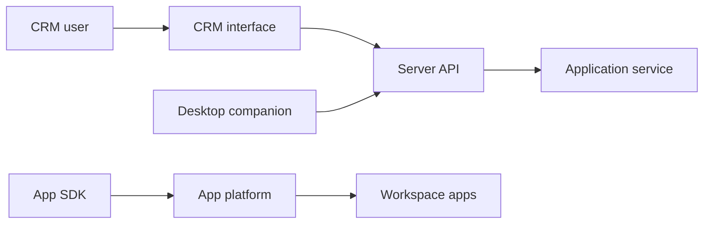

# twentyhq/twenty

> CRM open source que les équipes techniques construisent et versionnent comme le reste de leur code.

## Le problème
Les CRM classiques s'adaptent mal aux besoins métier complexes et évoluent difficilement avec l'entreprise.

## Ce que ça fait vraiment
Objets, vues, workflows et agents, définissables en code TypeScript avec le SDK (`defineObject`) puis publiés sur un espace de travail. Pile : NestJS, BullMQ, PostgreSQL, Redis côté serveur, React côté client. Le dépôt contient aussi une application compagnon d'enregistrement d'appels et des exemples.

## Comment c'est branché


## Essayer
```bash
npm install -g twenty
twenty app init my-app
twenty auth login --url https://your-workspace.twenty.com
twenty app publish --private
```

## Coût et pièges
Cloud en ligne ou auto-hébergement avec Docker Compose ; les tarifs ne sont pas indiqués. La licence n'est pas identifiée par GitHub.

## Ce que ce n'est pas
Pas un CRM clé en main sans développement : l'angle est « le CRM que tu construis ».

## Alternatives
Aucune alternative nommée dans le README.

## Pour toi
À surveiller : intéressant si ton équipe veut un CRM piloté par code et agents, mais éloigné du travail data / IA.

