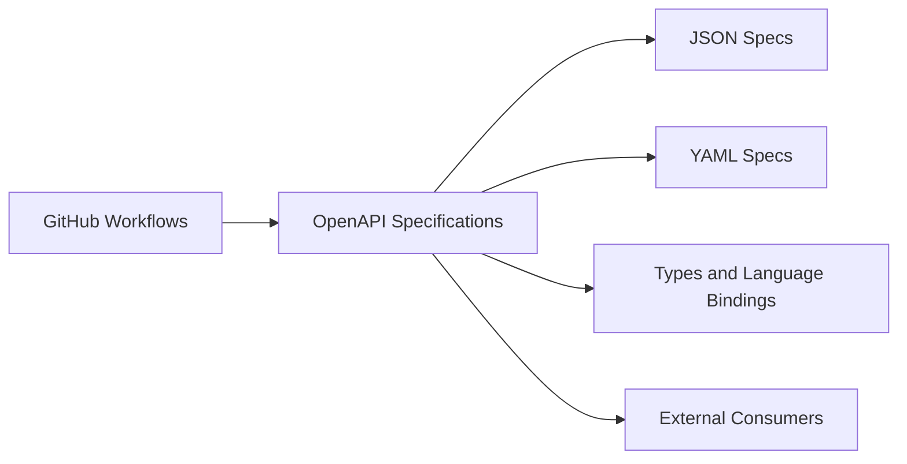

# twilio/twilio-oai

> OpenAPI JSON and YAML specifications of the Twilio API, to generate clients and tooling.

## The problem
Calling an API without a machine-readable contract forces you to write clients and validations by hand.

## What it actually does
The repository publishes Twilio's OpenAPI documents in `json/` and `yaml/`. The architecture described from the code also mentions a `types` folder, a Dockerfile, a Makefile and GitHub workflows (lint, test and deployment). The README details nothing more.

## How it is wired

## Trying it
No command documented. Fetch the files from the `json/` or `yaml/` folder and load them into an OpenAPI client generator.

## Cost and gotchas
Free. A Twilio account is still needed to actually call the API.

## What it is not
Not an SDK nor a client: only the specifications. The README is very short (under 800 characters).

## Alternatives
None cited in the README.

## For you
Watch: useful if you integrate Twilio (voice, SMS) into a pipeline and want to generate a typed client, of no interest otherwise.
