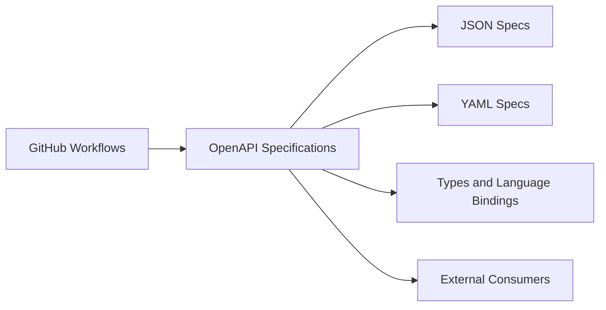

# twilio/twilio-oai

> Spécifications OpenAPI JSON et YAML de l'API Twilio, pour générer clients et outillage.

## Le problème
Appeler une API sans contrat machine-lisible oblige à écrire clients et validations à la main.

## Ce que ça fait vraiment
Le dépôt publie les documents OpenAPI de Twilio dans `json/` et `yaml/`. L'architecture décrite d'après le code mentionne aussi un dossier `types`, un Dockerfile, un Makefile et des workflows GitHub (lint, test et déploiement). Le README ne détaille rien de plus.

## Comment c'est branché

## Essayer
Aucune commande documentée. Récupérer les fichiers du dossier `json/` ou `yaml/` et les charger dans un générateur de client OpenAPI.

## Coût et pièges
Gratuit. Un compte Twilio reste nécessaire pour appeler réellement l'API.

## Ce que ce n'est pas
Pas un SDK ni un client : seulement les spécifications. Le README est très court (moins de 800 caractères).

## Alternatives
Aucune citée dans le README.

## Pour toi
Surveiller : utile si tu intègres Twilio (voix, SMS) dans un pipeline et veux générer un client typé, sans intérêt sinon.

