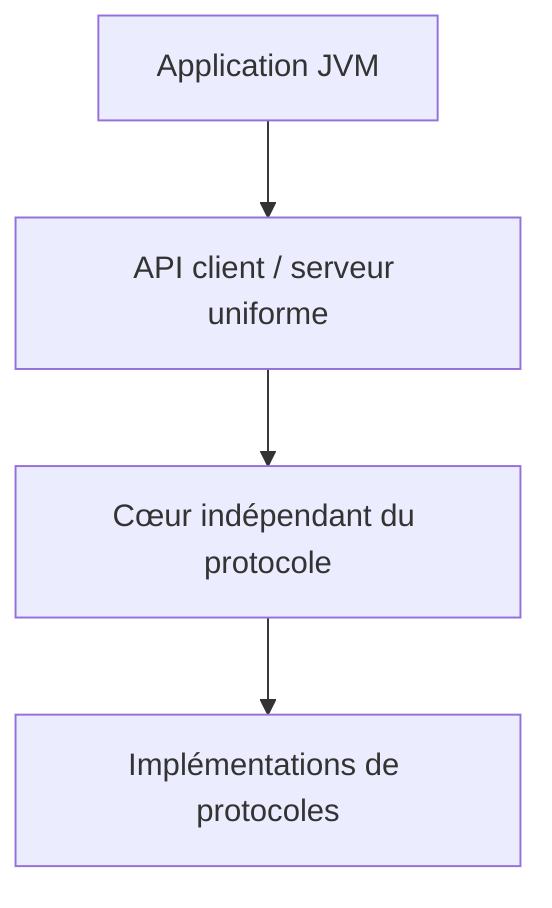

# twitter/finagle

> Extensible RPC system for the JVM, for building high-concurrency servers.

## The problem
Writing consistent network clients and servers for several protocols, under heavy load, on the JVM.

## What it actually does
Provides uniform client and server APIs for several protocols, whose code is largely protocol-independent. Used in production at Twitter and elsewhere (Foursquare, ING Bank, Pinterest, SoundCloud, Tumblr). Roughly monthly releases, without semver, with detailed changelogs.

## How it is wired

Diagram inferred from the README; no diagram provided.

## Trying it
No command documented in the supplied README; see the user guide on the site.

## Cost and gotchas
No cost. No semver: read the changelogs before each upgrade.

## What it is not
Not a web framework nor a data tool. The README is brief and points to external documentation.

## Alternatives
No alternative named in the README.

## For you
Ignore: JVM RPC infrastructure with no direct relation to everyday data/AI/MLOps work.
