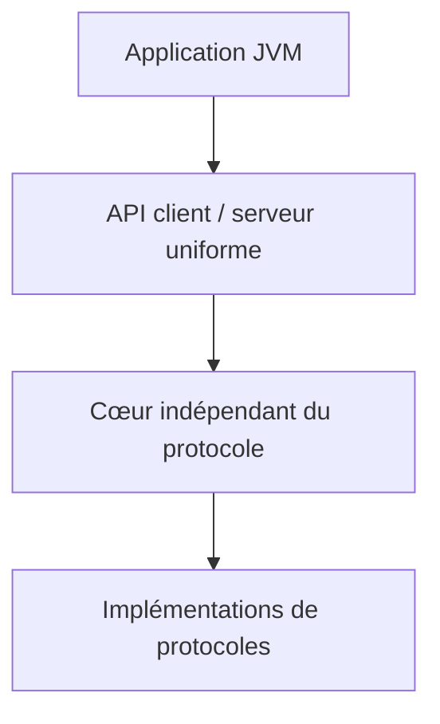

# twitter/finagle

> Système RPC extensible pour la JVM, pour construire des serveurs à forte concurrence.

## Le problème
Écrire des clients et serveurs réseau cohérents pour plusieurs protocoles, à forte charge, sur la JVM.

## Ce que ça fait vraiment
Fournit des API client et serveur uniformes pour plusieurs protocoles, dont le code est en grande partie indépendant du protocole. Utilisé en production chez Twitter et d'autres (Foursquare, ING Bank, Pinterest, SoundCloud, Tumblr). Versions mensuelles environ, sans semver, avec changelogs détaillés.

## Comment c'est branché

Schéma déduit du README ; aucun diagramme fourni.

## Essayer
Aucune commande documentée dans le README fourni ; voir le guide utilisateur du site.

## Coût et pièges
Aucun coût. Pas de semver : lire les changelogs avant chaque mise à jour.

## Ce que ce n'est pas
Pas un framework web ni un outil data. Le README est bref et renvoie à la documentation externe.

## Alternatives
Aucune alternative nommée dans le README.

## Pour toi
Ignorer : infrastructure RPC JVM sans rapport direct avec un travail data/IA/MLOps courant.

