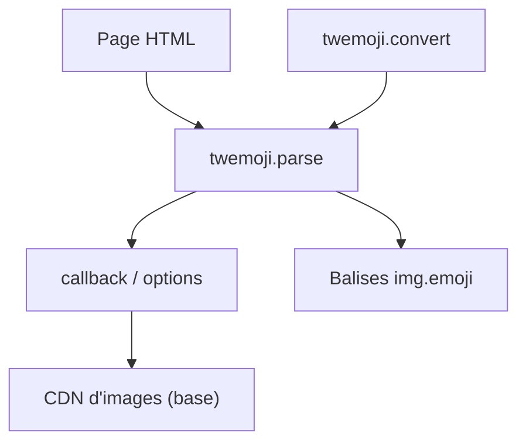

# twitter/twemoji

> JavaScript library that replaces the emoji on a page with images, for web developers.

## The problem
Emoji render differently depending on the system; you want identical rendering everywhere.

## What it actually does
`twemoji.parse` replaces emoji in DOM text nodes (without `innerHTML`) with `img` tags, or processes a string (discouraged, no sanitization). Options: base, ext, size, className, callback. Code point conversion utilities. Images come from a CDN by default.

## How it is wired
Simplified diagram based on the sheet, no diagram provided.



## Trying it
```js
twemoji.parse(document.body);
```

## Cost and gotchas
Free (MIT for the code; graphics under CC-BY 4.0 with mandatory attribution). Depends on a CDN for the default images. The README cites MaxCDN hosting.

## What it is not
Not an emoji picker. String mode sanitizes nothing. The README omits installation.

## Alternatives
None named in the README.

## For you
Ignore: useful only for web front-end work, unrelated to data / AI / MLOps.
