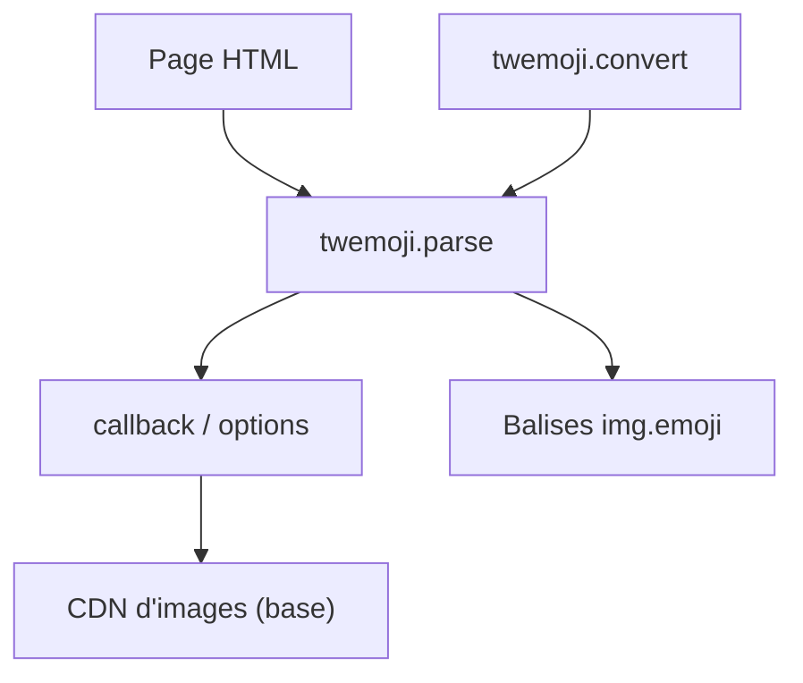

# twitter/twemoji

> Bibliothèque JavaScript qui remplace les emoji d'une page par des images, pour développeurs web.

## Le problème
Les emoji s'affichent différemment selon le système ; on veut un rendu identique partout.

## Ce que ça fait vraiment
`twemoji.parse` remplace les emoji dans les nœuds texte du DOM (sans `innerHTML`) par des balises `img`, ou traite une chaîne (déconseillé, pas d'assainissement). Options : base, ext, size, className, callback. Utilitaires de conversion de points de code. Les images viennent d'un CDN par défaut.

## Comment c'est branché
Schéma simplifié d'après la fiche, sans diagramme fourni.



## Essayer
```js
twemoji.parse(document.body);
```

## Coût et pièges
Gratuit (MIT pour le code ; graphiques en CC-BY 4.0 avec attribution obligatoire). Dépend d'un CDN pour les images par défaut. Le README cite un hébergement MaxCDN.

## Ce que ce n'est pas
Pas un sélecteur d'emoji. Le mode chaîne n'assainit rien. Le README omet l'installation.

## Alternatives
Aucune nommée dans le README.

## Pour toi
À ignorer : utile pour du front-end web uniquement, sans lien avec un travail data / IA / MLOps.

