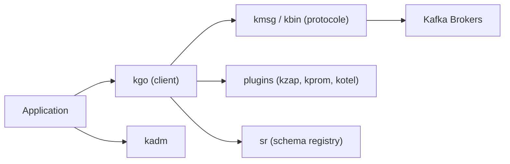

# twmb/franz-go

> Full-featured Apache Kafka client written in pure Go, for teams that produce and consume streams.

## The problem
Go Kafka clients are often partial or wrap a C library.

## What it actually does
It covers Kafka from 0.8.0 to 4.4+, with transactions and exactly-once, idempotent producers, consumer groups (including KIP-848), share groups, compression and SASL. Companion packages provide administration (`kadm`), a schema registry client (`sr`) and metrics and logging plugins. It works with Redpanda, Confluent, Event Hubs and MSK.

## How it is wired


## Trying it
```bash
go get github.com/twmb/franz-go
go get github.com/twmb/franz-go/plugin/kzap
go get github.com/twmb/franz-go/pkg/kadm
```
Then `kgo.NewClient(kgo.SeedBrokers(...), kgo.ConsumerGroup(...), kgo.ConsumeTopics(...))`.

## Cost and gotchas
Free. A Kafka cluster is required. Event Hubs does not accept compression on produce. Recreating a topic while a client is alive is discouraged.

## What it is not
Not a broker nor a stream analysis tool. It does not provide Kafka Streams-style stream processing.

## Alternatives
No alternative named in the README.

## For you
Adopt if you feed data pipelines in Go: complete and closely followed by its author, with cited users.
