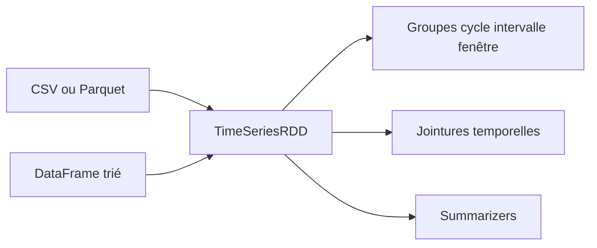

# twosigma/flint

> Two Sigma's Spark time-series library, for finance and IoT.

## The problem
Spark DataFrames ignore the natural order of time: temporal joins and windows on large volumes are slow or painful.

## What it actually does
It introduces `TimeSeriesRDD` (Scala) and `TimeSeriesDataFrame` (Python), which exploit the ordering of the data to parallelize by locality. It offers groupings (cycle, interval, windows), temporal joins with tolerance (`leftJoin`, `futureLeftJoin`) and summarizing functions (sum, z-score, correlation).

## How it is wired
Simplified diagram based on the fiche, no diagram provided.


## Trying it
```bash
sbt assemblyNoTest
pip install .
```
The `pip` command is run from the `python` subfolder.

## Cost and gotchas
Requires Spark 2.3 or 2.4, Scala 2.12 and Python 3.5 or later, with both artifacts (Maven and PyPI) for PySpark. Last push in July 2020: very old Spark versions.

## What it is not
It is not compatible with Spark 3 according to the README: only versions 2.3 and 2.4 are listed. It is not a forecasting tool, only a manipulation one.

## Alternatives
No alternative named in the README.

## For you
Ignore: inactive since 2020 and limited to Spark 2.x; keep it only as a reference for temporal joins.
