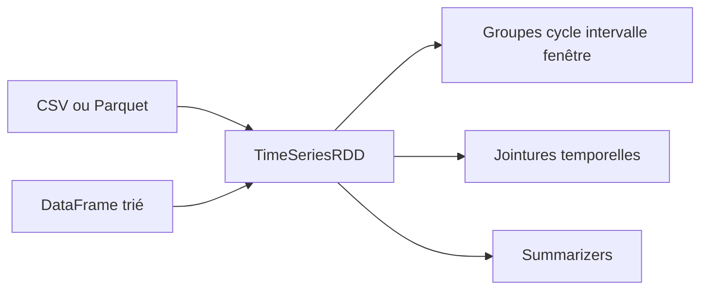

# twosigma/flint

> Bibliothèque Spark de séries temporelles de Two Sigma, pour la finance et l'IoT.

## Le problème
Les DataFrames Spark ignorent l'ordre naturel du temps : jointures temporelles et fenêtres sur de gros volumes sont lentes ou pénibles.

## Ce que ça fait vraiment
Elle introduit `TimeSeriesRDD` (Scala) et `TimeSeriesDataFrame` (Python), qui exploitent l'ordre des données pour paralléliser par localité. Elle offre des regroupements (cycle, intervalle, fenêtres), des jointures temporelles avec tolérance (`leftJoin`, `futureLeftJoin`) et des fonctions de synthèse (somme, z-score, corrélation).

## Comment c'est branché
Schéma simplifié d'après la fiche, sans diagramme fourni.


## Essayer
```bash
sbt assemblyNoTest
pip install .
```
La commande `pip` se lance depuis le sous-dossier `python`.

## Coût et pièges
Il faut Spark 2.3 ou 2.4, Scala 2.12 et Python 3.5 ou plus, avec les deux artefacts (Maven et PyPI) pour PySpark. Dernier push en juillet 2020 : versions Spark très anciennes.

## Ce que ce n'est pas
Ce n'est pas compatible avec Spark 3 d'après le README : seules les versions 2.3 et 2.4 sont listées. Ce n'est pas un outil de prévision, seulement de manipulation.

## Alternatives
Aucune alternative nommée dans le README.

## Pour toi
À ignorer : inactif depuis 2020 et limité à Spark 2.x ; garde-le seulement comme référence de jointures temporelles.

