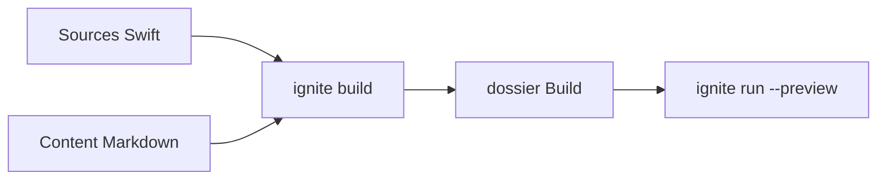

# twostraws/Ignite

> Static site generator in Swift with a SwiftUI-like syntax, for Apple developers.

## The problem
Building a website when you only know Swift forces you to learn HTML and CSS.

## What it actually does
You describe pages in Swift (`Text`, `Link`, `Accordion`, `Dropdown`, `CodeBlock`...) in a Swift package. The `ignite` CLI creates a project, builds the `Build` folder and starts a preview server. Markdown files in `Content` are rendered through layouts conforming to `ArticlePage`. Syntax highlighting for a dozen languages.

## How it is wired
No readable component provided by the diagram; schema inferred from the README.


## Trying it
```bash
git clone https://github.com/twostraws/Ignite
cd Ignite
make
make install
ignite new ExampleSite
cd ExampleSite
ignite build
ignite run --preview
```

## Cost and gotchas
Free; Swift toolchain required (Xcode rather, on macOS).

## What it is not
Does not convert SwiftUI to HTML: it is an API inspired by SwiftUI. Cannot be previewed by opening the HTML in the browser.

## Alternatives
No alternative named in the README.

## For you
Ignore: only useful if you already write Swift; for a data project site, a more common generator is enough.
