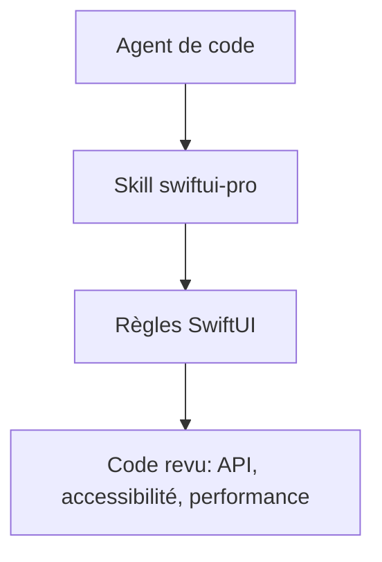

# twostraws/SwiftUI-Agent-Skill

> Coding-agent skill that guides the writing of more modern, accessible and performant SwiftUI.

## The problem
Coding agents produce outdated SwiftUI, poorly rendered for screen readers, or slow in use.

## What it actually does
Provides rules in the Agent Skills format that target common LLM mistakes: deprecated APIs, VoiceOver accessibility, performance, navigation, layout, animations, state. Works with Claude Code, Codex, Gemini, Cursor. Triggered by `/swiftui-pro` or in natural language. Complements three other skills by the author.

## How it is wired
Simplified diagram based on the sheet, no diagram provided.



## Trying it
```bash
npx skills add https://github.com/twostraws/swiftui-agent-skill --skill swiftui-pro
/plugin marketplace add twostraws/SwiftUI-Agent-Skill
/plugin install swiftui-pro@swiftui-agent-skill
```

## Cost and gotchas
Free. Requires Node for `npx`. Only useful for Apple development.

## What it is not
Not a SwiftUI library nor a generation tool: it is guidance for agents.

## Alternatives
- SwiftData Pro, Swift Concurrency Pro, Swift Testing Pro: complementary skills by the author.

## For you
Ignore: specific to SwiftUI, unless you develop on Apple; the idea of one skill per domain may inspire your own.
