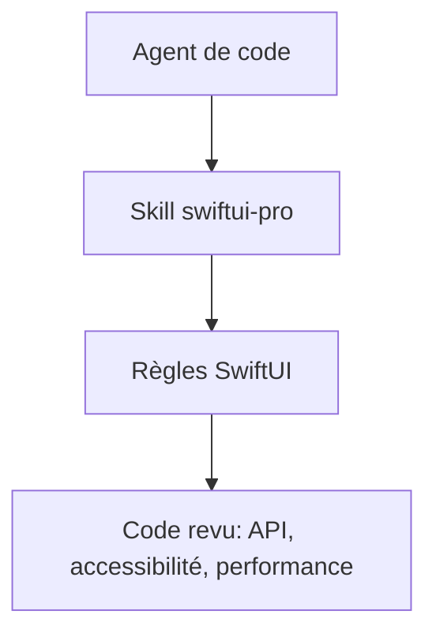

# twostraws/SwiftUI-Agent-Skill

> Skill d'agent de code qui guide l'écriture de SwiftUI plus moderne, accessible et performant.

## Le problème
Les agents de code produisent du SwiftUI obsolète, mal rendu aux lecteurs d'écran, ou lent à l'usage.

## Ce que ça fait vraiment
Fournit des règles au format Agent Skills qui ciblent les erreurs courantes des LLM : API dépréciées, accessibilité VoiceOver, performance, navigation, mise en page, animations, état. Fonctionne avec Claude Code, Codex, Gemini, Cursor. Se déclenche par `/swiftui-pro` ou en langage naturel. Complète trois autres skills de l'auteur.

## Comment c'est branché
Schéma simplifié d'après la fiche, sans diagramme fourni.



## Essayer
```bash
npx skills add https://github.com/twostraws/swiftui-agent-skill --skill swiftui-pro
/plugin marketplace add twostraws/SwiftUI-Agent-Skill
/plugin install swiftui-pro@swiftui-agent-skill
```

## Coût et pièges
Gratuit. Nécessite Node pour `npx`. Utile seulement pour le développement Apple.

## Ce que ce n'est pas
Pas une bibliothèque SwiftUI ni un outil de génération : ce sont des consignes pour agents.

## Alternatives
- SwiftData Pro, Swift Concurrency Pro, Swift Testing Pro : skills complémentaires de l'auteur.

## Pour toi
À ignorer : spécifique à SwiftUI, sauf si tu développes sur Apple ; l'idée de skill par domaine peut inspirer les tiens.

