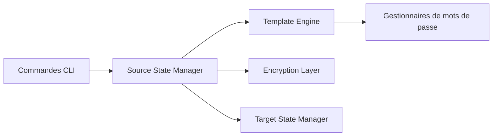

# twpayne/chezmoi

> Dotfiles manager for multiple machines, done securely.

## The problem
Keeping the same shell and tool configuration across several different machines, without exposing secrets.

## What it actually does
The README is three lines long and points to chezmoi.io. According to the architecture description (inferred from the file tree, not verified in the code), it separates source state from target state, handles templates, encrypts via age or gpg and reads password managers (1Password, Bitwarden, LastPass, KeePassXC). It is written in Go.

## How it is wired

## Trying it
No command documented in the README (refers to chezmoi.io).

## Cost and gotchas
Free. The README says nothing about installation or prerequisites; everything is in the external documentation.

## What it is not
It is not a server configuration management tool. Minimal sheet: the README alone does not allow saying more.

## Alternatives
No alternative cited in the README.

## For you
Watch: useful if you juggle between laptop, GPU workstation and servers, but the verdict relies on the external docs, not on this README.
