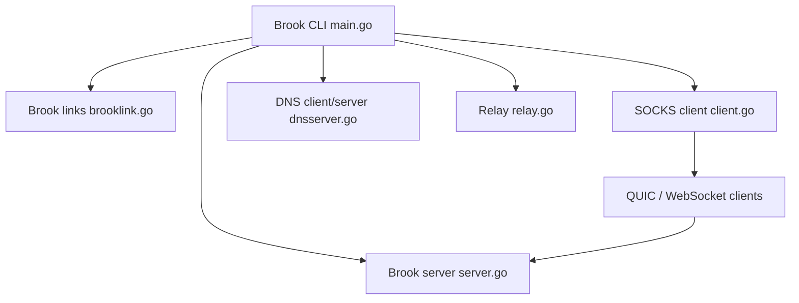

# txthinking/brook

> Cross-platform networking tool in Go: server, client and relay to route traffic through a proxy.

## The problem
Routing the network traffic of a machine or device through a server of your choice, with a client available on every system.

## What it actually does
A single binary, driven from the command line, that plays several roles: proxy server and client (SOCKS), relay directly or via Brook, DNS services (DNS, DoH, DHCP). According to the code, transport goes over TCP/UDP with stream and packet framing, or over QUIC and WebSocket. `brook link` links are used to customize parameters. The README mentions scripts and network plugins (gallery on brook.app), without detail; clients exist for iOS, Android, macOS, Windows, Linux and OpenWrt.

## How it is wired


## Trying it
```bash
bash <(curl https://bash.ooo/nami.sh)
nami install brook
brook server -l :9999 -p hello
```

## Cost and gotchas
Free; you need a server of your own for the server side. The README cites a sponsor (Shiliew) and the documentation is external (txthinking.com). The install script is run directly from a URL: review it before use.

## What it is not
Not a turnkey VPN nor a hosted service. A dual-use tool (network privacy, but also circumventing filtering): its use must respect the law of the country and the rules of the network concerned.

## Alternatives
The README cites no alternative; not documented.

## For you
Worth watching: useful for relaying traffic or testing network paths, but far from everyday data/MLOps work, and the maintainer is a single person.
