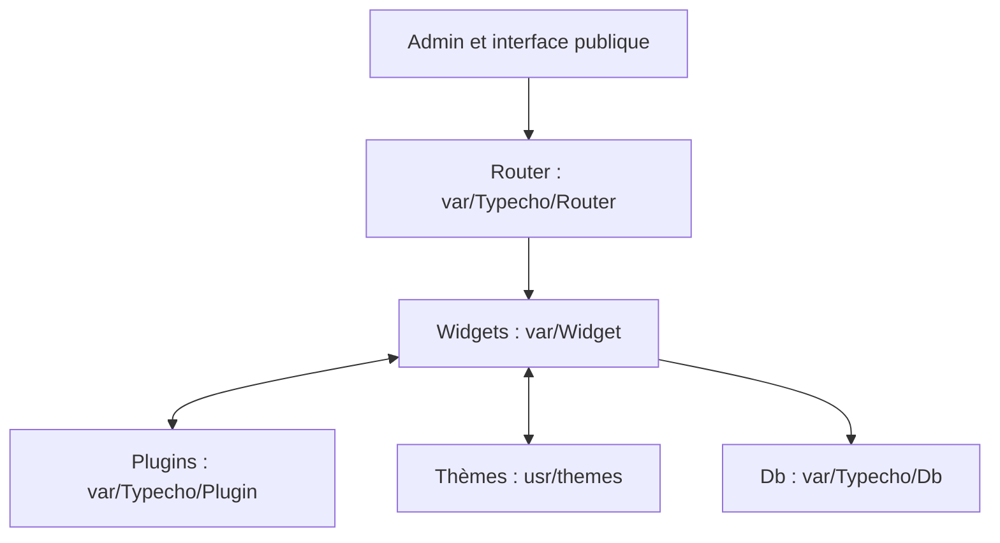

# typecho/typecho

> PHP blog engine with Markdown, plugins and themes, for those who host their own blog.

## The problem
Publishing a lightweight blog without going through a heavy content management system.

## What it actually does
PHP 7.4 or later software supporting several databases (MariaDB, MySQL, SQLite, PostgreSQL), with Markdown, plugins, themes, custom fields and free-form pages. The diagram shows a router, content widgets, users and comments, and a database abstraction layer. The README is very short.

## How it is wired


## Trying it
```bash
# Aucune commande documentée dans le README.
```

## Cost and gotchas
Free; you need a PHP 7.4 or later server and a database.

## What it is not
Not a data or AI tool. The README claims "the most powerful blog engine", which it does not demonstrate. GPL-2.0 license.

## Alternatives
No alternative cited in the README.

## For you
Ignore: a PHP blog engine, unrelated to data, AI or MLOps.
