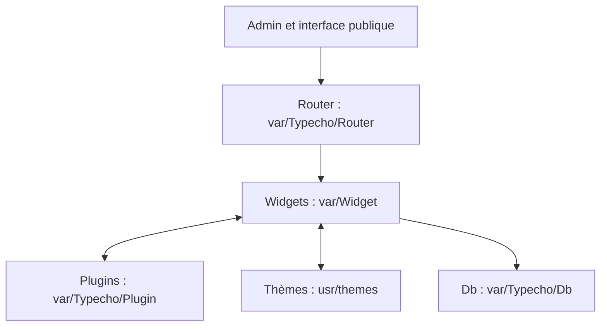

# typecho/typecho

> Moteur de blog en PHP avec Markdown, plugins et thèmes, pour qui héberge son propre blog.

## Le problème
Publier un blog léger sans passer par un gros système de gestion de contenu.

## Ce que ça fait vraiment
Logiciel PHP 7.4 ou plus avec plusieurs bases (MariaDB, MySQL, SQLite, PostgreSQL), Markdown, plugins, thèmes, champs personnalisés et pages libres. Le diagramme montre un routeur, des widgets de contenu, utilisateurs et commentaires, une couche d'abstraction de base de données. Le README est très court.

## Comment c'est branché


## Essayer
```bash
# Aucune commande documentée dans le README.
```

## Coût et pièges
Gratuit ; il faut un serveur PHP 7.4 ou plus et une base de données.

## Ce que ce n'est pas
Pas un outil data ni IA. Le README annonce « le moteur de blog le plus puissant », ce qu'il ne démontre pas. Licence GPL-2.0.

## Alternatives
Aucune alternative citée dans le README.

## Pour toi
À ignorer : moteur de blog PHP, sans rapport avec la data, l'IA ou le MLOps.

