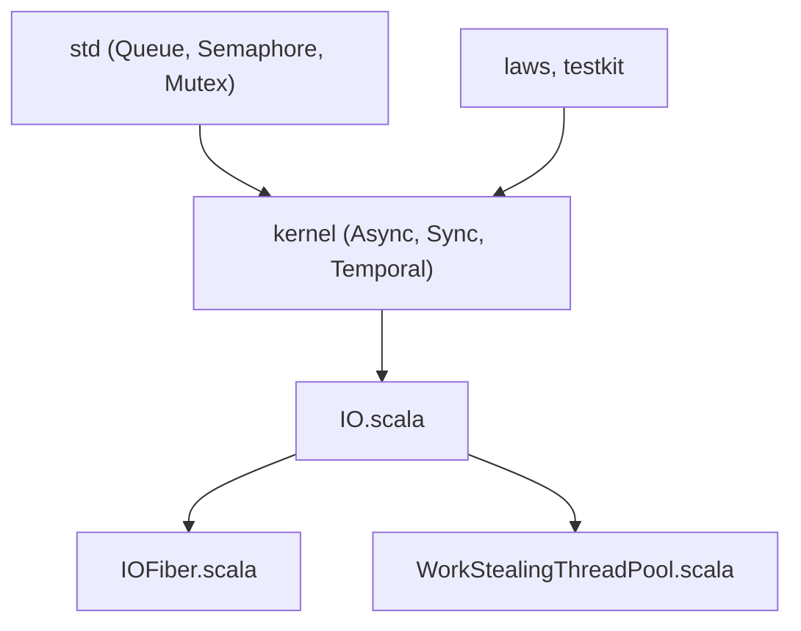

# typelevel/cats-effect

> Pure functional runtime for Scala: fibers, resources and safe concurrency, for Scala developers.

## The problem
Writing asynchronous and concurrent programs in Scala without resource leaks or thread blocking, with controlled side effects.

## What it actually does
Provides the IO type, type classes (Sync, Async, Concurrent, Temporal, MonadCancel), a std library (Queue, Semaphore, Mutex, Deferred, Resource, Console, Random) and a work-stealing scheduler. Published for JVM, Scala.js and Native. Five rules: wrap effects in delay/blocking, use Resource, never block outside of blocking, use IOApp.

## How it is wired


## Trying it
```bash
sbt new typelevel/ce3.g8
```
```scala
libraryDependencies += "org.typelevel" %% "cats-effect" % "3.7.1"
```

## Cost and gotchas
Free. Requires mastering Scala functional programming and applying the five rules; the "55 times faster" benchmark is the author's, to be measured on your own setup. Version 2.5.5 is end-of-life.

## What it is not
Not a web framework nor a data tool. Not usable outside Scala.

## Alternatives
No alternative named in the README (Monix and Fs2 are cited as part of the ecosystem).

## For you
Ignore unless you have a Scala/Spark stack: proven but outside the usual Python ecosystem of data/AI.
