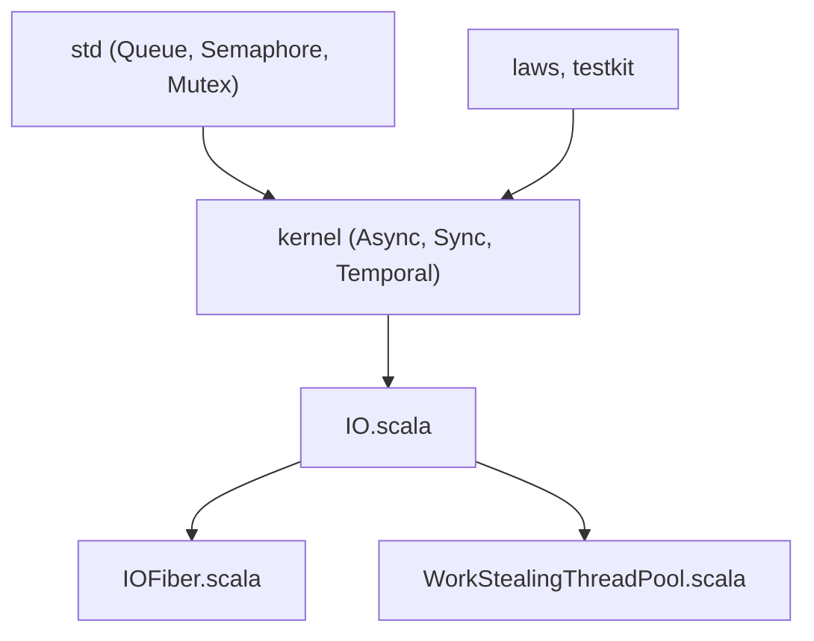

# typelevel/cats-effect

> Runtime fonctionnel pur pour Scala : fibres, ressources et concurrence sûres, pour développeurs Scala.

## Le problème
Écrire en Scala des programmes asynchrones et concurrents sans fuite de ressources ni blocage de threads, avec des effets de bord contrôlés.

## Ce que ça fait vraiment
Fournit le type IO, des classes de types (Sync, Async, Concurrent, Temporal, MonadCancel), une bibliothèque std (Queue, Semaphore, Mutex, Deferred, Resource, Console, Random) et un ordonnanceur à vol de tâches. Publié pour JVM, Scala.js et Native. Cinq règles : envelopper les effets dans delay/blocking, utiliser Resource, ne jamais bloquer en dehors de blocking, utiliser IOApp.

## Comment c'est branché


## Essayer
```bash
sbt new typelevel/ce3.g8
```
```scala
libraryDependencies += "org.typelevel" %% "cats-effect" % "3.7.1"
```

## Coût et pièges
Gratuit. Demande de maîtriser la programmation fonctionnelle Scala et d'appliquer les cinq règles ; le benchmark « 55 fois plus rapide » est celui de l'auteur, à mesurer chez soi. La version 2.5.5 est en fin de vie.

## Ce que ce n'est pas
Pas un framework web ni un outil de données. Pas utilisable hors Scala.

## Alternatives
Aucune alternative nommée dans le README (Monix et Fs2 sont cités comme écosystème).

## Pour toi
À ignorer sauf pile Scala/Spark : éprouvé mais hors de l'écosystème Python habituel du data/IA.

