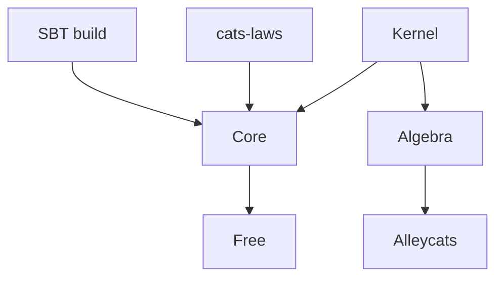

# typelevel/cats

> Scala library of functional programming abstractions (type classes, data structures).

## The problem
The Scala standard library is hybrid and offers no common, binary-compatible functional foundation.

## What it actually does
Cats provides type classes (functor, monad, applicative), free structures, and test laws to verify its instances. The modules are separate (`cats-kernel`, `cats-core`, `cats-free`, `cats-laws`, `cats-testkit`, `algebra`, `alleycats-core`) and the library runs on the JVM, Scala.js and Scala Native. Binary compatibility follows semantic versioning.

## How it is wired


## Trying it
```bash
scalacOptions += "-Ypartial-unification"
libraryDependencies += "org.typelevel" %% "cats-core" % "2.9.0"
```
Put these in `build.sbt` (the first setting applies to Scala 2.12 only).

## Cost and gotchas
Free. Requires a Scala project with sbt. The license is "present but unidentified" according to GitHub. The README shows version 2.9.0, old relative to the repository: check the current version.

## What it is not
Not an application framework: cats-effect, mtl or kittens live in other repositories. You do not need to know category theory.

## Alternatives
No alternative named; the README cites neighboring modules (`cats-effect`, `cats-mtl`, `kittens`).

## For you
Ignore unless you do Scala (Spark, for example): it is a functional programming foundation, not a data tool.
