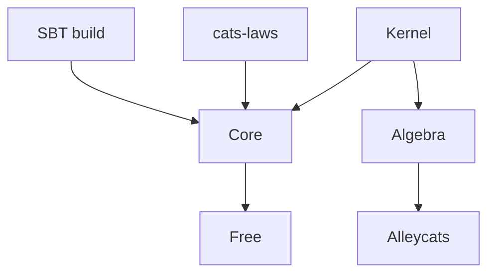

# typelevel/cats

> Bibliothèque Scala d'abstractions de programmation fonctionnelle (classes de types, structures de données).

## Le problème
La bibliothèque standard Scala est hybride et n'offre pas de socle fonctionnel commun et compatible en binaire.

## Ce que ça fait vraiment
Cats fournit des classes de types (foncteur, monade, applicatif), des structures libres et des lois de test pour vérifier ses instances. Les modules sont séparés (`cats-kernel`, `cats-core`, `cats-free`, `cats-laws`, `cats-testkit`, `algebra`, `alleycats-core`) et la bibliothèque tourne sur JVM, Scala.js et Scala Native. La compatibilité binaire suit le versionnage sémantique.

## Comment c'est branché


## Essayer
```bash
scalacOptions += "-Ypartial-unification"
libraryDependencies += "org.typelevel" %% "cats-core" % "2.9.0"
```
À mettre dans `build.sbt` (le premier réglage vaut pour Scala 2.12 seulement).

## Coût et pièges
Gratuit. Il faut un projet Scala avec sbt. La licence est « présente mais non identifiée » par GitHub. Le README affiche la version 2.9.0, ancienne par rapport au dépôt : vérifie la version courante.

## Ce que ce n'est pas
Ce n'est pas un framework d'application : cats-effect, mtl ou kittens vivent dans d'autres dépôts. Il n'est pas nécessaire de connaître la théorie des catégories.

## Alternatives
Aucune alternative nommée ; le README cite des modules voisins (`cats-effect`, `cats-mtl`, `kittens`).

## Pour toi
À ignorer sauf si tu fais du Scala (Spark, par exemple) : c'est un socle de programmation fonctionnelle, pas un outil data.

