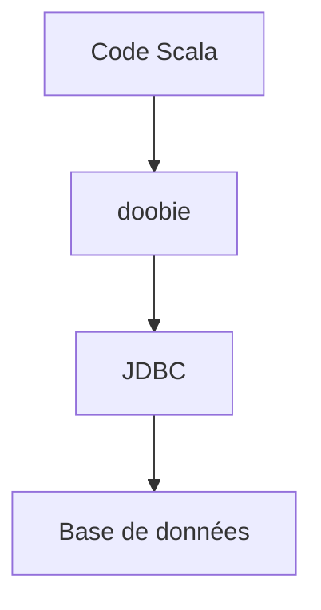

# typelevel/doobie

> A purely functional JDBC layer for Scala, for accessing databases.

## The problem
Raw JDBC forces imperative code and side effects that functional Scala programs want to avoid.

## What it actually does
The README gives no detail: it describes doobie as a purely functional JDBC layer for Scala and points to the microsite for the rest. The project has existed since 2013 and remains active.

## How it is wired
Simplified diagram based on the sheet, no diagram provided.

## Trying it
No command documented in the README, which points to the microsite and to the doobie_quick_start template for reproducing a problem.

## Cost and gotchas
Not documented in the README. You need a Scala project and a JDBC driver.

## What it is not
Not an ORM nor a data tool: a SQL access library for Scala. The README material is too short to say more.

## Alternatives
No alternative named in the README.

## For you
Ignore: useful only if you write functional Scala, which is rare in a data, AI or MLOps profile centered on Python.
