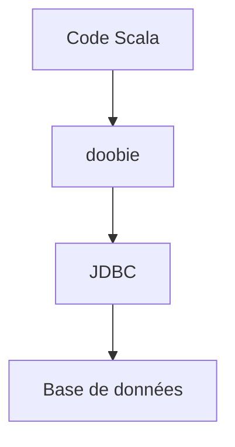

# typelevel/doobie

> Une couche JDBC purement fonctionnelle pour Scala, pour accéder aux bases de données.

## Le problème
Le JDBC brut impose du code impératif et des effets de bord que les programmes fonctionnels en Scala veulent éviter.

## Ce que ça fait vraiment
Le README ne détaille rien : il décrit doobie comme une couche JDBC purement fonctionnelle pour Scala et renvoie au microsite pour la suite. Le projet existe depuis 2013 et reste actif.

## Comment c'est branché
Schéma simplifié d'après la fiche, sans diagramme fourni.

## Essayer
Aucune commande documentée dans le README, qui renvoie au microsite et au modèle doobie_quick_start pour reproduire un problème.

## Coût et pièges
Non documenté dans le README. Il faut un projet Scala et un pilote JDBC.

## Ce que ce n'est pas
Pas un ORM ni un outil data : une bibliothèque d'accès SQL pour Scala. La matière du README est trop courte pour en dire davantage.

## Alternatives
Aucune alternative nommée dans le README.

## Pour toi
À ignorer : utile seulement si tu écris du Scala fonctionnel, ce qui est rare dans un profil data, IA ou MLOps centré sur Python.

