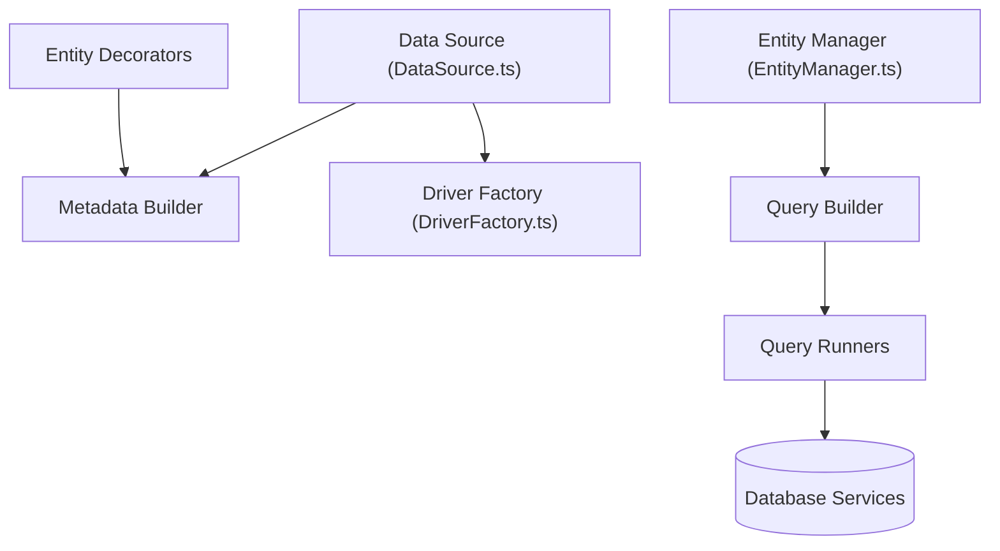

# typeorm/typeorm

> ORM for TypeScript and JavaScript, which handles many databases and runs on Node and other platforms.

## The problem
Writing SQL and the object-to-table mapping by hand is repetitive and hard to maintain.

## What it actually does
Entities described by decorators or schemas, entity manager, repositories, relations, transactions, automatically generated migrations, QueryBuilder, query cache, logging. Supports both Active Record and Data Mapper. Databases: MySQL, MariaDB, Postgres, CockroachDB, SQLite, SQL Server, Oracle, SAP HANA, Spanner, MongoDB.

## How it is wired

## Trying it
No installation command in the README; it shows code examples (`User` entity, `userRepository.save`, `find`, `findOneBy`) and points to example repositories.

## Cost and gotchas
Free. You must choose a database driver and enable TypeScript decorators: the detail is not in the README.

## What it is not
Not a data-analysis or pipeline tool. It is application-side database access.

## Alternatives
No alternative named in the README.

## For you
Mostly useful if you build Node/TypeScript APIs around relational databases; little related to data/AI work: worth watching.
