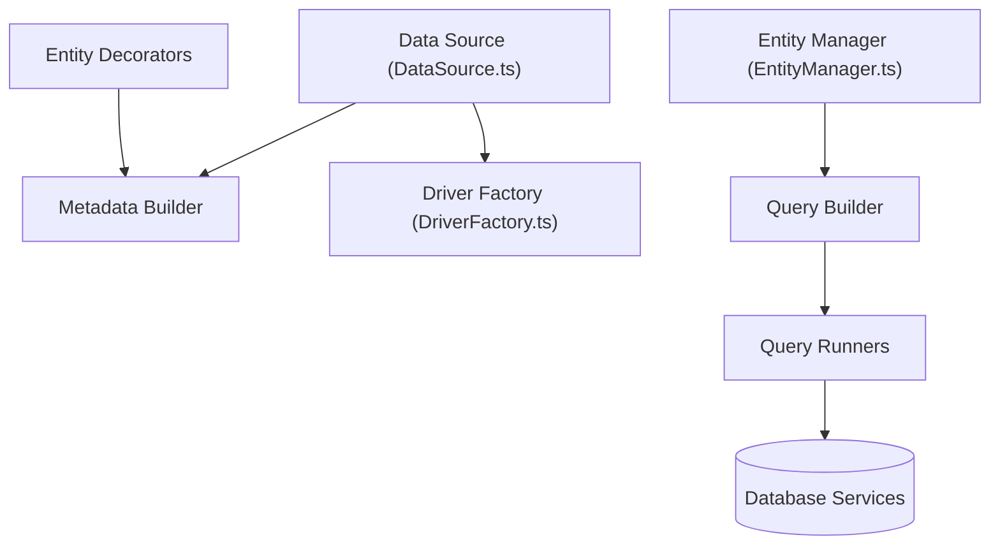

# typeorm/typeorm

> ORM pour TypeScript et JavaScript, qui gère de nombreuses bases de données et fonctionne sur Node et d'autres plateformes.

## Le problème
Écrire à la main le SQL et la correspondance objets-tables est répétitif et difficile à maintenir.

## Ce que ça fait vraiment
Entités décrites par décorateurs ou schémas, gestionnaire d'entités, dépôts, relations, transactions, migrations générées automatiquement, QueryBuilder, cache de requêtes, journalisation. Compatible Active Record et Data Mapper. Bases : MySQL, MariaDB, Postgres, CockroachDB, SQLite, SQL Server, Oracle, SAP HANA, Spanner, MongoDB.

## Comment c'est branché

## Essayer
Aucune commande d'installation dans le README ; il montre des exemples de code (entité `User`, `userRepository.save`, `find`, `findOneBy`) et renvoie vers des dépôts d'exemples.

## Coût et pièges
Gratuit. Choisir un pilote de base et activer les décorateurs TypeScript : le détail n'est pas dans le README.

## Ce que ce n'est pas
Pas un outil d'analyse de données ni de pipelines. C'est un accès aux bases côté application.

## Alternatives
Aucune alternative nommée dans le README.

## Pour toi
Utile surtout si tu construis des API Node/TypeScript autour de bases relationnelles ; peu lié au travail data/IA : à surveiller.

