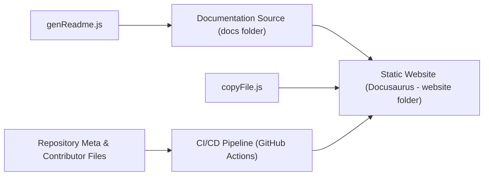

# typescript-cheatsheets/react

> Cheat sheet for typing React applications with TypeScript, with copy-ready examples.

## The problem
Typing React hooks, refs, context and events requires memorizing many special cases.

## What it actually does
A long README covering: function and class components, hooks (useState, useReducer, useRef, useImperativeHandle...), props, forms and events, context, refs (including the React 19 ref-prop), portals, error boundaries and concurrent React. The content is also published as a Docusaurus site.

## How it is wired

The architecture text is a drawing guide; Netlify hosting is inferred from it.

## Trying it
```bash
npx create-next-app@latest --ts
npx create-remix@latest
npm init gatsby --ts
npx create-expo-app -t with-typescript
npm create vite@latest my-app -- --template react-ts
```

## Cost and gotchas
Free. The advice changes with React and TypeScript versions (React 19, TS 5.1): read the cited version before applying an example.

## What it is not
Neither a library nor a course: it is an opinionated cheat sheet that already assumes basic React and TypeScript.

## Alternatives
No alternative named in the README.

## For you
Worth watching: a useful bookmark if you are building a React front end for an AI tool, of no interest otherwise.
