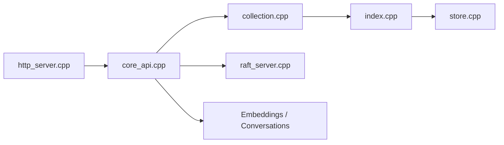

# typesense/typesense

> Typo-tolerant search engine with vector and semantic search, in a single binary.

## The problem
Setting up fast, typo-tolerant search with Elasticsearch is heavy, and Algolia quickly gets expensive.

## What it actually does
A C++ server exposed over HTTP: collections, filtering, facets, sorting, geosearch, joins, vector search, hybrid search (built-in embeddings or via OpenAI), conversational RAG, natural-language search, image search (CLIP) and voice search (Whisper). Raft for the cluster. Official clients for JavaScript, PHP, Python, Ruby.

## How it is wired


## Trying it
```bash
docker run -p 8108:8108 -v/tmp/data:/data typesense/typesense:29.0 --data-dir /data --api-key=Hu52dwsas2AdxdE
pip install typesense
bazel build //:typesense-server
```

## Cost and gotchas
Free when self-hosted; Typesense Cloud is paid (dedicated cluster, hourly rate). In-memory index: 14 GB of RAM for 28 M books according to the README. GPL-3.0 license. Some AI features call external providers (keys at your expense).

## What it is not
Not a primary database nor a petabyte-scale logging tool; Algolia still has the personalization and server-side analytics that Typesense lacks.

## Alternatives
Elasticsearch (heavier, for very large volumes); Algolia (proprietary service, more expensive at scale).

## For you
Adopt for hybrid or semantic search with built-in RAG, in a single binary that is easy to operate, keeping an eye on the GPL.
