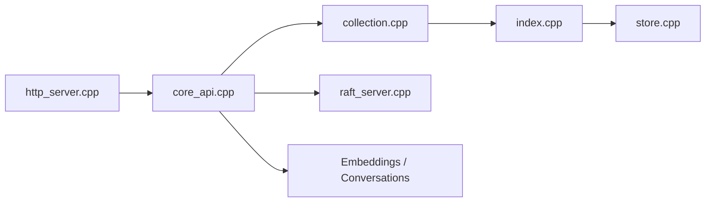

# typesense/typesense

> Moteur de recherche tolérant aux fautes de frappe, avec recherche vectorielle et sémantique, en un seul binaire.

## Le problème
Mettre en place une recherche rapide et tolérante aux fautes avec Elasticsearch est lourd, et Algolia coûte vite cher.

## Ce que ça fait vraiment
Serveur C++ exposé en HTTP : collections, filtrage, facettes, tri, géorecherche, jointures, recherche vectorielle, hybride (embeddings intégrés ou via OpenAI), RAG conversationnel, recherche en langage naturel, par image (CLIP) et vocale (Whisper). Raft pour le cluster. Clients officiels JavaScript, PHP, Python, Ruby.

## Comment c'est branché


## Essayer
```bash
docker run -p 8108:8108 -v/tmp/data:/data typesense/typesense:29.0 --data-dir /data --api-key=Hu52dwsas2AdxdE
pip install typesense
bazel build //:typesense-server
```

## Coût et pièges
Gratuit auto-hébergé ; Typesense Cloud est payant (grappe dédiée, tarif horaire). Index en mémoire : 14 Go de RAM pour 28 M de livres selon le README. Licence GPL-3.0. Certaines fonctions IA appellent des fournisseurs externes (clés à ta charge).

## Ce que ce n'est pas
Pas une base de données principale ni un outil de logs à l'échelle du pétaoctet ; Algolia a encore la personnalisation et l'analytique serveur que Typesense n'a pas.

## Alternatives
Elasticsearch (plus lourd, pour de très gros volumes) ; Algolia (service propriétaire, plus coûteux à l'échelle).

## Pour toi
À adopter pour une recherche hybride ou sémantique avec RAG intégré, en un binaire facile à exploiter, en gardant l'œil sur la GPL.

