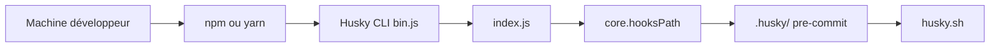

# typicode/husky

> npm tool that simplifies installing native Git hooks in a project.

## The problem
Running checks (lint, tests) before each commit requires managing Git hooks that are not versioned.

## What it actually does
The README contains only an address; the rest comes from the architecture based on the code. Husky relies on the Git setting `core.hooksPath` to point to a versioned `.husky/` folder. The CLI (`bin.js`) delegates to a module (`index.js`), and shell scripts run the hooks. Zero dependencies, integration tests as shell scripts.

## How it is wired

## Trying it
No command documented in the README (a single address pointing to https://typicode.github.io/husky).

## Cost and gotchas
Free. Requires Node and Git. Last push dates from March 2026; 107 open issues. Insufficient material here to detail usage: read the documentation site.

## What it is not
Not a lint or test tool: it only triggers what you tell it to at Git events.

## Alternatives
No alternative named in the README.

## For you
Worth watching: handy for enforcing lint and tests before commit in a JavaScript repo; outside the data/AI core, and to be checked on the official site since the README is empty.
