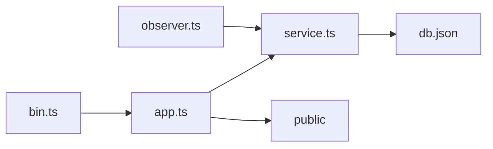

# typicode/json-server

> Full fake REST API from a JSON file, to prototype a frontend without a backend.

## The problem
Developing or testing a client while the real API does not exist yet forces you to code a throwaway server.

## What it actually does
You write a `db.json` or `db.json5`; `json-server` exposes CRUD routes per key (arrays and objects), with filters (`views:gt=100`), sorting, pagination, `_embed`, `_where`, cascading delete and static files from `./public`. The code describes an Express server, an in-memory service and a file watcher.

## How it is wired


## Trying it
```bash
npm install json-server
npx json-server db.json
curl http://localhost:3000/posts/1
```

## Cost and gotchas
Free. The documentation displayed is the v1 beta: breaking changes possible, with v0 to v1 migration notes (string id, `_per_page`, `_embed`).

## What it is not
It is not a production database: data is in memory, with no authentication described. Anomaly: the architecture report cites a "Fair Source License", while the catalog says MIT; the catalog prevails.

## Alternatives
No alternative named in the README.

## For you
Adopt it: handy for simulating a scoring or data API while a dashboard is being developed.
