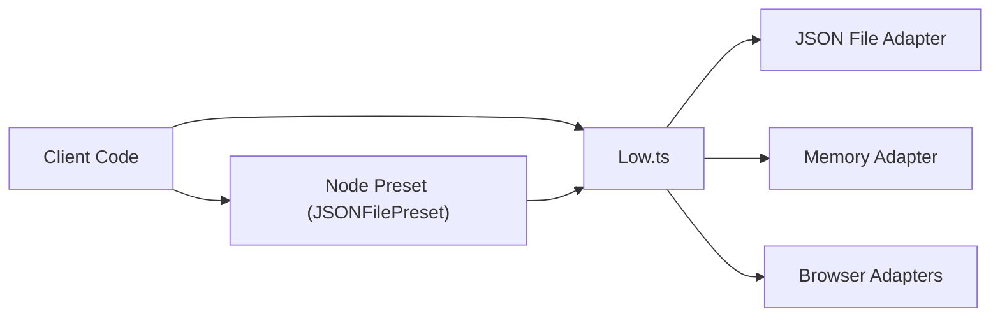

# typicode/lowdb

> Small, typed, local JSON database for JavaScript scripts and apps.

## The problem
For a prototype or a CLI tool, installing a real database is disproportionate; writing JSON by hand exposes you to corrupted writes.

## What it actually does
`db.data` is a plain JavaScript object that you modify then write with `db.write()` or `db.update()`.
Atomic writes; queries via native array methods or lodash.
Adapters: JSON file, memory (for tests), localStorage/sessionStorage, text, custom formats (YAML, encryption).
ESM-only package, TypeScript typing.

## How it is wired


## Trying it
```bash
npm install lowdb
```

## Cost and gotchas
Free. Every `write` reserializes all of `db.data`: slow beyond 10–100 MB. Incompatible with Node's cluster module.

## What it is not
Not a production database: the README recommends PostgreSQL or MongoDB to scale. No concurrency between processes.

## Alternatives
- PostgreSQL: recommended by the README as soon as you need to scale.
- MongoDB: same reason.

## For you
Ignore: a JavaScript prototyping tool; in Python you already have SQLite or a simple file for these uses.
