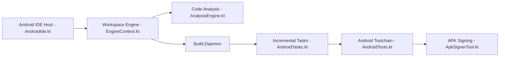

# tyron12233/CodeAssist

> IDE that edits and builds Android and Java projects entirely on the phone, without a Gradle daemon.

## The problem
A real Gradle runtime is too heavy for a phone: without a laptop, no Android build.

## What it actually does
Models projects itself, builds a DAG of incremental tasks with a cache and drives aapt2, D8/R8 and apksigner directly to produce, sign and install an APK. Java completion (Eclipse JDT), Kotlin completion (beta), block editing, Android XML help, on-device Git, Compose preview and a built-in AI agent. Compose Multiplatform interface, Android and desktop launchers. Benchmark figures come from the maintainer.

## How it is wired


## Trying it
```bash
CI_CORE_ONLY=true ./gradlew check
./gradlew :ide-desktop:run
./gradlew :ide-android:assembleDebug
```

## Cost and gotchas
Free. Installation via Google Play (testing), F-Droid or IzzyOnDroid; signatures differ by channel, so no cross-channel updates. JDK 17+. The model provider for the AI agent is not specified.

## What it is not
Not a replacement for Android Studio: Gradle support is partial (compatibility described elsewhere). Only Android and Java projects are targeted.

## Alternatives
None named in the README.

## For you
Watch: interesting as an example of a lightweight IDE with an embedded agent; no direct use for your data/AI profile.
