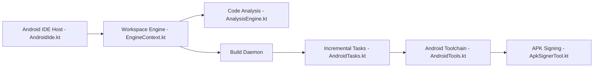

# tyron12233/CodeAssist

> IDE qui édite et compile des projets Android et Java entièrement sur le téléphone, sans démon Gradle.

## Le problème
Un vrai runtime Gradle est trop lourd pour un téléphone : sans portable, pas de build Android.

## Ce que ça fait vraiment
Modélise les projets lui-même, compile un DAG de tâches incrémentales avec cache et pilote directement aapt2, D8/R8 et apksigner pour produire, signer et installer un APK. Complétion Java (Eclipse JDT), complétion Kotlin (bêta), édition par blocs, aide XML Android, Git sur appareil, aperçu Compose et un agent IA intégré. Interface Compose Multiplatform, lanceurs Android et bureau. Les chiffres de benchmark viennent du mainteneur.

## Comment c'est branché


## Essayer
```bash
CI_CORE_ONLY=true ./gradlew check
./gradlew :ide-desktop:run
./gradlew :ide-android:assembleDebug
```

## Coût et pièges
Gratuit. Installation par Google Play (test), F-Droid ou IzzyOnDroid ; signatures différentes selon le canal, donc pas de mise à jour croisée. JDK 17+. Le fournisseur du modèle de l'agent IA n'est pas précisé.

## Ce que ce n'est pas
Pas un remplaçant d'Android Studio : le support Gradle est partiel (compatibilité décrite ailleurs). Seuls les projets Android et Java sont visés.

## Alternatives
Aucune nommée dans le README.

## Pour toi
Surveiller : intéressant comme exemple d'IDE léger avec agent embarqué ; sans usage direct pour ton profil data/IA.

