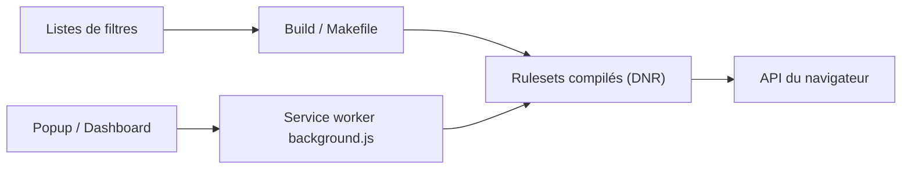

# uBlockOrigin/uBOL-home

> A lightweight content blocker for browsers, based on the MV3 declarative API.

## The problem
Blocking ads and trackers without a permanent process that is hungry for CPU and memory.

## What it actually does
Compiles filter lists (uBlock Origin, EasyList, EasyPrivacy, Peter Lowe) into static rulesets enforced by the browser; the service worker is active only for the popup and the options. Separate trees for Chromium, Firefox and Safari, settings manageable through managed storage.

## How it is wired


## Trying it
```bash
# Aucune commande : installation depuis Chrome Web Store, Firefox Add-ons,
# Edge Add-ons ou Safari App Store.
```

## Cost and gotchas
Free. Filter issues are reported through the chat icon in the extension, not on GitHub.

## What it is not
A lightened version: less complete than classic uBlock Origin, limited by the declarative model. This repo serves as a showcase ("home").

## Alternatives
- uBlock Origin: the full blocker, mentioned by the name of its filter set.

## For you
Ignore for monitoring: a consumer extension, unrelated to data/AI/MLOps work.
