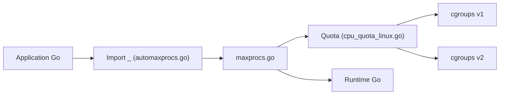

# uber-go/automaxprocs

> Go library that adjusts GOMAXPROCS to the Linux container's CPU quota; for Go services under Docker or Kubernetes.

## The problem
In a container limited to 2 CPUs, Go sees all of the machine's cores: too many threads, throttling and tail latency that skyrockets.

## What it actually does
A blank import of the package is enough: at startup, it reads the cgroups CPU quota (v1 or v2) and sets `GOMAXPROCS` accordingly. A configurable API exists. On Uber's dispatcher with a 200% quota, aligning GOMAXPROCS to the quota gives 44,715 req/s versus 22,191 with the default value (24), and removes the observed throttling.

## How it is wired


## Trying it
```bash
go get -u go.uber.org/automaxprocs
# puis dans le code : import _ "go.uber.org/automaxprocs"
```

## Cost and gotchas
Free, no configuration. The README's measurements come from an internal Uber workload, not reproduced here. Last push late 2025: stable, little evolution.

## What it is not
Concerns only Go and Linux quotas; no effect outside a limited container. Does not tune memory.

## Alternatives
Not documented in the README: no alternative named.

## For you
Useful only if you operate Go services (gateways, sidecars) in containers; without Go in your data/AI stack, you have no use for it.
