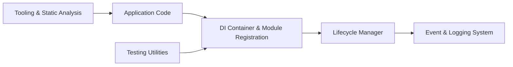

# uber-go/fx

> Dependency injection system for Go applications, used in most of Uber's Go services.

## The problem
Go applications end up relying on global variables and `init()` functions, which make the code hard to test and to share between teams.

## What it actually does
Fx provides an injection container: you declare constructors (`provide`, `supply`), and it resolves the dependencies and drives the lifecycle (ordered startup and shutdown). It emits events (`fxevent`, `fxlog`), provides a test package `fxtest` and a linter `fxlint`.

## How it is wired


## Trying it
```bash
go get go.uber.org/fx@v1
```

## Cost and gotchas
Free. Version v1, strict SemVer: no breaking changes before v2.0.0. Each major Go version is supported until two newer versions are released.

## What it is not
Not a web framework nor a data tool: it is plumbing for Go services. The README does not compare Fx to other injectors.

## Alternatives
No alternative named in the README.

## For you
Ignore: a Go library for structuring services, with no direct use in data, AI or MLOps, unless you write Go services yourself.
