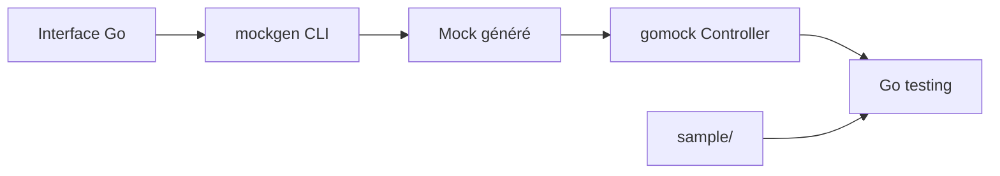

# uber-go/mock

> Mocking framework for Go, with the `mockgen` generator, maintained by Uber after golang/mock was abandoned.

## The problem
Testing Go code that depends on interfaces forces you to write test doubles by hand.

## What it actually does
`mockgen` generates mocks from a source file, an archive or a package (source, archive, package modes). In tests, a gomock controller records expectations (`EXPECT().Bar(...).Return(...)`). Custom formatters tailor failure messages, and the `-typed` option produces typed returns.

## How it is wired


## Trying it
```bash
go install go.uber.org/mock/mockgen@latest
mockgen -version
mockgen -source=foo.go [other options]
mockgen database/sql/driver Conn,Driver
```

## Cost and gotchas
Free. Check that `GOPATH/bin` is in the `PATH`.

## What it is not
Not an integration testing tool. The original project, golang/mock, is no longer maintained by Google.

## Alternatives
- golang/mock: the original repository, no longer maintained by Google.

## For you
Ignore unless you write Go services: useful for an MLOps engineer testing operators or APIs in Go.
