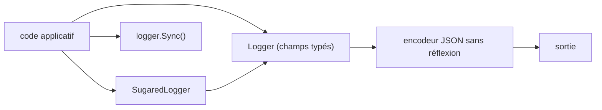

# uber-go/zap

> Structured, leveled logging for Go, for code that logs in the hot path.

## The problem
Serializing `interface{}` values with `encoding/json` and `fmt.Fprintf` burns CPU and multiplies
small allocations: the logger becomes the service's bottleneck.

## What it actually does
Two APIs. The `SugaredLogger` accepts loosely typed key-value pairs and a `printf` style.
The stricter `Logger` accepts only typed fields (`zap.String`, `zap.Int`, `zap.Duration`)
and allocates significantly less. Underneath: a JSON encoder with no reflection and no allocation. The
README publishes its own measurements: 656 ns/op and 5 allocations for a message with 10 fields, 67 ns/op and
0 allocations when the context is already attached to the logger.

## How it is wired


## Trying it
```bash
go get -u go.uber.org/zap
```
```go
logger, _ := zap.NewProduction()
defer logger.Sync()
logger.Info("failed to fetch URL",
  zap.String("url", url),
  zap.Int("attempt", 3),
  zap.Duration("backoff", time.Second),
)
```

## Cost and gotchas
Free, no service dependency. The only stated constraint: zap supports only the last two
minor versions of Go. Forgetting `defer logger.Sync()` leaves lines in the buffer.

## What it is not
Not a collector nor a backend: zap writes, it neither stores nor indexes. The typed `Logger` offers no
`printf` formatting — that is the price of zero allocation. The README's figures come from
its own benchmark suite, and the README itself invites you to take them with caution.

## Alternatives
- `zerolog`: faster than zap on all three published benchmarks (380 ns/op, 1 allocation).
- `slog` (standard library): zero dependencies, ~3× slower on the 10-field benchmark.
- `logrus`: the former standard, the slowest in the published tables.

## For you
The default choice if you write service Go; otherwise `slog` is plenty for tooling.
