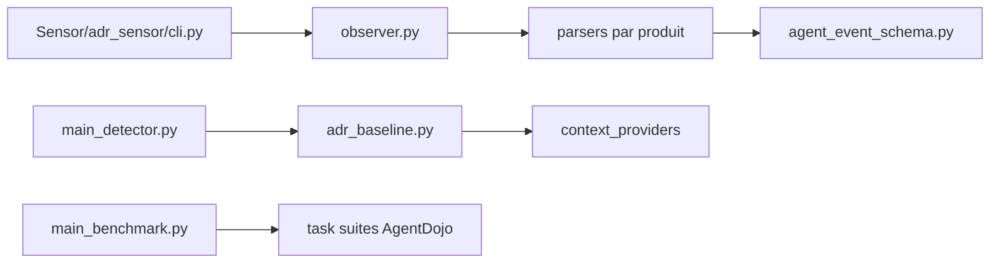

# uber/ADR

> Detection and response system for AI agents: an endpoint sensor, an attack benchmark and a detector.

## The problem
Coding agents (Claude Code, Cursor, Codex) run tools and MCP servers on workstations without security teams seeing what they do.

## What it actually does
The repo publishes four building blocks: Discovery (inventory of AI apps and MCP servers), Sensor (normalized telemetry from Claude Code, Cursor, Codex, Gemini CLI, etc.), ADR-Bench (300+ tasks, 134 simulated MCP servers, based on AgentDojo) and the dual-agent detector, with LlamaFirewall as a key-free alternative. Prevention and the offline Explorer are not published.

## How it is wired


## Trying it
```bash
git clone https://github.com/uber/ADR
cd ADR/Detection
uv sync
export ANTHROPIC_API_KEY="..." OPENAI_API_KEY="..."
```

## Cost and gotchas
The default detector calls the Anthropic and OpenAI APIs: cost is on you. For a key-free trial, use `--detector llamafirewall`. The benchmark data is synthetic (fake credentials, prompt injections): defensive use only.

## What it is not
Not a complete product: prevention is missing. The README announces 300+ tasks and then 304 in the table; Uber's own deployment cannot be reproduced with this repo alone.

## Alternatives
LlamaFirewall (baseline provided), AgentDojo (embedded for the benchmark).

## For you
Keep an eye on it: a useful reference for evaluating AI agent security (reproducible benchmark), to be tested before any deployment on workstations.
