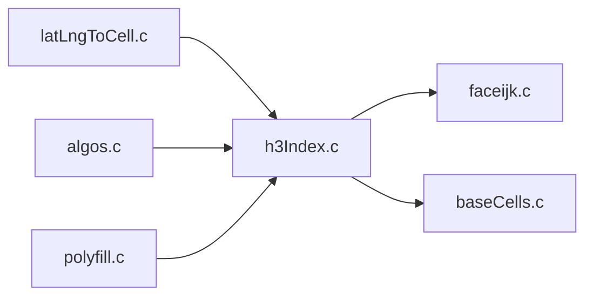

# uber/h3

> A hierarchical hexagonal grid geospatial indexing system, in C, for those analyzing location data.

## The problem
Aggregating and comparing geographic points over regular areas is awkward with squares or irregular polygons.

## What it actually does
It converts latitude and longitude into a hexagonal cell identifier (resolutions 0 to 15), gives its boundary and center, and handles neighborhoods, hierarchy, polygon filling and directed edges. Bindings exist for Java, JavaScript, Python and other languages. Command-line tools are provided.

## How it is wired


## Trying it
```bash
mkdir build
cd build
cmake -DCMAKE_BUILD_TYPE=Release ..
make
./bin/latLngToCell --resolution 10 --latitude 40.689167 --longitude -74.044444
```

## Cost and gotchas
Free. Compilation with CMake and a C compiler; precompiled bindings are recommended. `brew install h3` exists on macOS.

## What it is not
Not a database nor a mapping tool: a cell index. The grid is approximate, subdivisions do not nest exactly.

## Alternatives
- S2: cited as a reference for hierarchical subdivisions.

## For you
Watch: useful for geospatial feature engineering, with the Python binding, as soon as a project aggregates position data.
