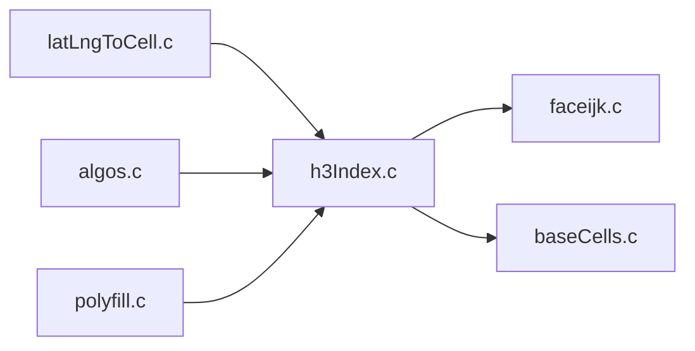

# uber/h3

> Un système d'indexation géospatiale en grille hexagonale hiérarchique, en C, pour qui analyse des données de localisation.

## Le problème
Agréger et comparer des points géographiques sur des zones régulières est malaisé avec des carrés ou des polygones irréguliers.

## Ce que ça fait vraiment
Elle convertit latitude et longitude en un identifiant de cellule hexagonale (résolutions 0 à 15), donne sa frontière et son centre, et gère voisinages, hiérarchie, remplissage de polygones et arêtes dirigées. Des liaisons existent pour Java, JavaScript, Python et d'autres langages. Des outils en ligne de commande sont fournis.

## Comment c'est branché


## Essayer
```bash
mkdir build
cd build
cmake -DCMAKE_BUILD_TYPE=Release ..
make
./bin/latLngToCell --resolution 10 --latitude 40.689167 --longitude -74.044444
```

## Coût et pièges
Gratuit. Compilation avec CMake et un compilateur C ; les liaisons précompilées sont recommandées. `brew install h3` existe sur macOS.

## Ce que ce n'est pas
Pas une base de données ni un outil de cartographie : un index de cellules. La grille est approximative, les sous-divisions ne s'emboîtent pas exactement.

## Alternatives
- S2 : cité comme référence de subdivisions hiérarchiques.

## Pour toi
À surveiller : utile en feature engineering géospatial, avec la liaison Python, dès qu'un projet agrège des données de position.

