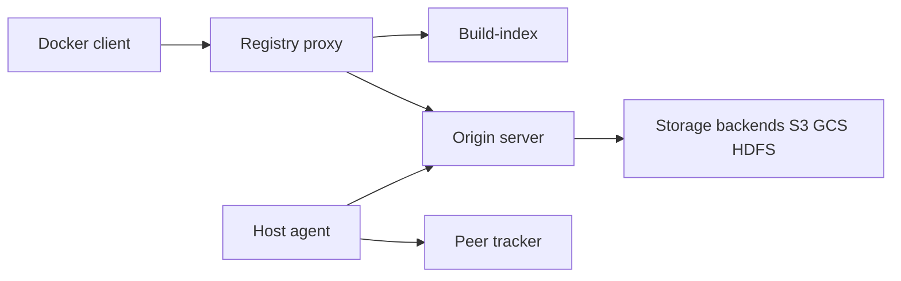

# uber/kraken

> Uber's P2P Docker registry for distributing large images very quickly to thousands of hosts.

## The problem
When thousands of nodes pull the same image, the central registry becomes the bottleneck.

## What it actually does
Agents on each host exchange blobs between peers, orchestrated by a tracker. Origin seeders store blobs on S3, GCS, ECR or HDFS, a proxy receives pushes and a build-index maps tags to digests, with cross-cluster replication. In production at Uber since 2018.

## How it is wired


## Trying it
```bash
make images
make devcluster
helm install --name=kraken-demo ./helm
```

## Cost and gotchas
Several components to deploy and a storage backend to provide. Mutating a tag (`latest`) causes cache and replication problems. Recommended limit of 20 GB per blob.

## What it is not
Does not magically make `docker pull` faster if the registry is not the bottleneck (decompression often dominates).

## Alternatives
Dragonfly (Alibaba, central supervisor, less scalable according to the README); BitTorrent (designed for untrusted environments).

## For you
Worth watching: relevant if you distribute heavy model images to many GPU nodes; too heavy for a small cluster.
