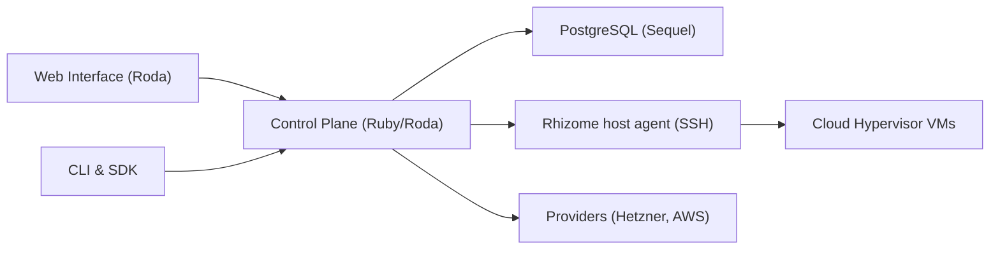

# ubicloud/ubicloud

> Open source IaaS cloud that runs on bare metal (Hetzner, AWS Bare Metal), self-hosted or managed.

## The problem
The big clouds are expensive and lock you in; building your own cloud on bare metal is complex.

## What it actually does
A Ruby control plane (Roda, Sequel, Rodauth) keeps the desired state in PostgreSQL. State machines ("progs") run commands over SSH on the hosts. Services: Cloud Hypervisor VMs, managed Postgres, Kubernetes, GitHub Actions runners, AI inference, networking (IPsec, nftables). Block storage comes from ubiblk.

## How it is wired


## Trying it
```bash
git clone git@github.com:ubicloud/ubicloud.git
./demo/generate_env
docker-compose -f demo/docker-compose.yml up
docker exec -it ubicloud-app ./demo/cloudify_server
```

## Cost and gotchas
The managed service is paid; self-hosting requires rented machines (Hetzner) and the provider credentials in `.env`. IPv6 is required, or a tunnel.

## What it is not
Not a full AWS clone: the project aims at 10% of the services for 80% of the consumption. Self-hosting: the "cloudification" script only handles Hetzner.

## Alternatives
- OpenStack: more general-purpose, but heavier to operate according to the README.

## For you
Worth watching: interesting for cheaper CI runners or GPU/inference; read the AGPL if you modify it to offer a service.
